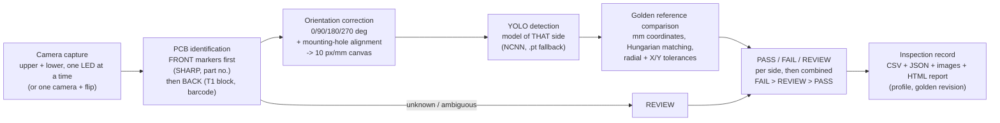
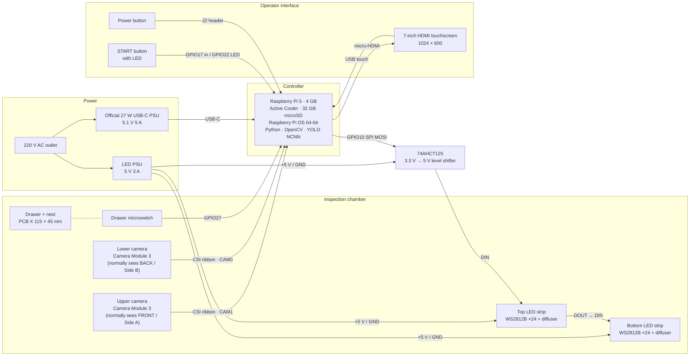

# PCB X — Portable Edge-AI Inspection Chamber (capstone implementation package) — V2

**"Portable Edge-AI Inspection Chamber for Dual-Sided PCB Component Detection and
Tri-Tier (Pass, Fail, Review) Classification."** Runs completely on a Raspberry
Pi 5 — no cloud. Version 2 of the existing repository: same objectives, same
golden-reference and PASS / FAIL / REVIEW approach; updated for **two Raspberry
Pi Camera Module 3** units, PCB side identification from the board's own
markings, automatic orientation correction, a PCB profile folder for trained
models, and tolerance editing in the GUI. What changed and why:
`docs/01_V2_Evaluation_and_Changes.md` and `CHANGELOG.md`.

**Final prototype configuration:** Raspberry Pi 5 (4 GB) · **2 × Camera Module 3
Standard** — lower camera on CAM0, upper camera on CAM1 · 2 × WS2812B strips on
one SPI data line through a 74AHCT125 level shifter · 7″ HDMI touchscreen ·
START button, drawer switch, power button · 32 GB high-endurance microSD.

## 0. Complete workflow



| Front | Back | Overall |
|---|---|---|
| PASS | PASS | PASS |
| PASS | FAIL | FAIL |
| FAIL | PASS | FAIL |
| PASS | REVIEW | REVIEW |
| REVIEW | FAIL | FAIL |
| REVIEW | REVIEW | REVIEW |

## Quick start

```bash
# Raspberry Pi (Raspberry Pi OS 64-bit with desktop)
git clone <your-repo> ~/PCBX_Capstone && cd ~/PCBX_Capstone/pcbx_inspection
./install_pi.sh && sudo reboot
source ~/pcbx-venv/bin/activate && cd ~/PCBX_Capstone/pcbx_inspection
python -m pytest -q tests             # simulated tests (39 + GUI test on a desktop)
python tools/test_cameras.py --list   # two imx708 cameras?
python tools/check_profile.py         # what is still missing (markers, golden, models)
./run_pcbx.sh                         # the appliance (shows NOT READY + the list until set up)
```
Set-up order: hardware (`docs/A_Hardware.md`) → cameras/LEDs/calibration →
identification markers and holes (`docs/PCB_IDENTIFICATION_AND_ORIENTATION.md`)
→ dataset and training (`docs/DATASET_LABELING.md`, `docs/MODEL_TRAINING.md`)
→ install model (`docs/MODEL_INTEGRATION.md`) → golden reference and tolerances
(`docs/GOLDEN_REFERENCE_AND_TOLERANCES.md`) → testing (`docs/D_Testing_and_Validation.md`).

---

## 1. Block diagram



**Signal summary**

| From | To | Interface |
|---|---|---|
| Lower camera | Pi 5 CAM0 | MIPI CSI-2, Standard–Mini cable (22-pin → 15-pin) |
| Upper camera | Pi 5 CAM1 | MIPI CSI-2, Standard–Mini cable (22-pin → 15-pin) |
| Pi 5 GPIO10 | 74AHCT125 → top strip DIN → bottom strip DIN | SPI MOSI, WS2812 data (800 kHz) |
| START button | Pi 5 GPIO17 | digital in, internal pull-up |
| START button LED | Pi 5 GPIO22 | digital out |
| Drawer microswitch | Pi 5 GPIO27 | digital in, internal pull-up |
| Power button | Pi 5 J2 | power on / safe shutdown |
| Touchscreen | Pi 5 HDMI0 + USB | video + touch |

---

## 2. Detailed schematic

```
                        ┌─────────────────────────── 220 V AC ───────────────────────────┐
                        │                                                                │
              ┌─────────┴─────────┐                                         ┌────────────┴───────────┐
              │ Official 27 W PSU │                                         │  5 V 3 A LED adapter   │
              │ USB-C 5.1 V / 5 A │                                         │  (+) 5V      (−) GND   │
              └─────────┬─────────┘                                         └─────┬──────────┬───────┘
                        │ USB-C                                                   │          │
                        ▼                                                  +5V_LED│          │GND
 ┌──────────────────────────────────────────────────────┐                        │   C1     │
 │                  RASPBERRY PI 5 (4 GB)               │                        ├──┤├──────┤  C1 = 1000 µF / 10 V
 │                                                      │                        │  (+)  (−)│      (at strip input)
 │  CAM0 [22-pin] ◄═══ ribbon ═══ LOWER  Camera Module 3│                        │          │
 │  CAM1 [22-pin] ◄═══ ribbon ═══ UPPER  Camera Module 3│                        │          │
 │  HDMI0 ═══ micro-HDMI ═══► 7" touchscreen (HDMI in)  │                        │          │
 │  USB 2.0 ◄═══ USB ═══ touchscreen (touch / power*)   │                        │          │
 │  FAN ◄═══ Active Cooler                              │                        │          │
 │  J2 (PWR BUT) ●──[ S3 POWER, momentary NO ]──●       │                        │          │
 │                                                      │                        │          │
 │  J8 40-pin header (only used pins shown)             │     U1 74AHCT125 (DIP-14, powered from 5 V)
 │                                                      │     ┌──────────────────────┐   │          │
 │  pin 19  GPIO10 / SPI0 MOSI ─────────────────────────┼────►│2  1A          VCC 14│◄──┘          │
 │                                                      │  ┌─►│1  1OE         4OE 13│◄── +5V_LED    │
 │  pin 6   GND ────────────────────────────────────────┼──┼─►│7  GND          4A 12│──► GND        │
 │                         (COMMON GROUND) ─────────────┼──┴──┼──────────────────────┼───────────────┤
 │                                                      │     │4  2OE ◄─ +5V   4Y 11│ n.c.          │
 │                                                      │     │5  2A  ◄─ GND  3OE 10│◄── +5V_LED    │
 │                                                      │     │6  2Y  n.c.     3A  9│──► GND        │
 │                                                      │     │3  1Y ──┐       3Y  8│ n.c.          │
 │                                                      │     └────────┼─────────────┘               │
 │                                                      │              │  R1 330 Ω                   │
 │                                                      │              └──/\/\/──┐                    │
 │                                                      │                        ▼                    │
 │                                                      │   ┌────────────────────────────────────┐   │
 │                                                      │   │ TOP STRIP  WS2812B × 24            │   │
 │                                                      │   │ +5V ◄── +5V_LED   GND ──► GND ─────┼───┤
 │                                                      │   │ DIN (input end)  …  DOUT (out end) │   │
 │                                                      │   └──────────────────────────┬─────────┘   │
 │                                                      │                   data wire  │             │
 │                                                      │   ┌──────────────────────────▼─────────┐   │
 │                                                      │   │ BOTTOM STRIP  WS2812B × 24         │   │
 │                                                      │   │ +5V ◄── +5V_LED   GND ──► GND ─────┼───┘
 │                                                      │   │ DIN                    DOUT  n.c.  │
 │                                                      │   └────────────────────────────────────┘
 │                                                      │
 │  pin 11  GPIO17 ────────[ S1 START, momentary NO ]───┼── pin 9  GND     (internal pull-up, pressed = LOW)
 │  pin 13  GPIO27 ────────[ S2 drawer microswitch  ]───┼── pin 14 GND     (NO contact: drawer closed = LOW)
 │  pin 15  GPIO22 ──/\/\/──►|────────────────────────── ┼── pin 20 GND     (START button LED)
 │                  R2 330 Ω  D1                        │
 └──────────────────────────────────────────────────────┘
   * Power the touchscreen from its own USB/5 V input if it flickers; do not use J8 5 V pins for LEDs.
```

**Component list for the schematic**

| Ref | Part | Value / type | Notes |
|---|---|---|---|
| — | Raspberry Pi 5 | 4 GB | official Active Cooler on FAN header |
| CAM0 | Camera Module 3 (standard) | 12 MP, autofocus | bottom side, SMD parts |
| CAM1 | Camera Module 3 (standard) | 12 MP, autofocus | top side, THT parts |
| U1 | 74AHCT125 | quad buffer, DIP-14 | 3.3 V → 5 V level shifter, VCC = 5 V |
| R1 | Resistor | 330 Ω ¼ W | in series with DIN, close to the first LED |
| R2 | Resistor | 330 Ω ¼ W | START LED current limit (skip if the button LED has a built-in resistor) |
| C1 | Electrolytic capacitor | 1000 µF 10 V | across +5V_LED/GND at the strip input; mind polarity |
| D1 | LED | built into S1 | START "ready" indicator |
| S1 | Push button | momentary NO, 16–22 mm | START |
| S2 | Microswitch with lever | NO contact | closed when the drawer is fully in |
| S3 | Push button | momentary NO | to J2 (PWR BUT) |
| LED1 | WS2812B strip | 24 LEDs, 5 V, 60/m | top strip, first in the chain |
| LED2 | WS2812B strip | 24 LEDs, 5 V, 60/m | bottom strip, fed from LED1 DOUT |
| PSU1 | Official Raspberry Pi 27 W USB-C | 5.1 V 5 A | Pi only |
| PSU2 | DC adapter | 5 V 3 A | LEDs + U1 only |

---

## 3. Pinouts

### 3.1 Raspberry Pi 5 J8 40-pin header

`◄` = used in this prototype. Pins marked *SPI0 reserved* are claimed when SPI is enabled; don't use them for anything else.

| Function | GPIO | Pin | Pin | GPIO | Function |
|---|---|---|---|---|---|
| 3V3 | — | 1 | 2 | — | 5V |
| SDA1 | GPIO2 | 3 | 4 | — | 5V |
| SCL1 | GPIO3 | 5 | 6 | — | **GND ◄ common ground to U1 / LED PSU** |
| — | GPIO4 | 7 | 8 | GPIO14 | TXD |
| GND | — | 9 | 10 | GPIO15 | RXD |
| **START button S1 ◄** | **GPIO17** | **11** | 12 | GPIO18 | — |
| **Drawer switch S2 ◄** | **GPIO27** | **13** | **14** | — | **GND ◄ S2** |
| **START LED D1 ◄** | **GPIO22** | **15** | 16 | GPIO23 | — |
| 3V3 | — | 17 | 18 | GPIO24 | — |
| **SPI0 MOSI → U1 1A ◄** | **GPIO10** | **19** | **20** | — | **GND ◄ D1** |
| SPI0 MISO *(SPI0 reserved)* | GPIO9 | 21 | 22 | GPIO25 | — |
| SPI0 SCLK *(SPI0 reserved)* | GPIO11 | 23 | 24 | GPIO8 | SPI0 CE0 *(SPI0 reserved)* |
| GND | — | 25 | 26 | GPIO7 | SPI0 CE1 *(SPI0 reserved)* |
| ID_SD (do not use) | GPIO0 | 27 | 28 | GPIO1 | ID_SC (do not use) |
| — | GPIO5 | 29 | 30 | — | GND |
| — | GPIO6 | 31 | 32 | GPIO12 | spare (MOSFET option, top) |
| spare (MOSFET option, bottom) | GPIO13 | 33 | 34 | — | GND |
| — | GPIO19 | 35 | 36 | GPIO16 | — |
| — | GPIO26 | 37 | 38 | GPIO20 | — |
| GND | — | 39 | 40 | GPIO21 | — |

S1 uses pin 9 (GND) as its return. All GND pins are connected together on the board.

### 3.2 Other Raspberry Pi 5 connectors

| Connector | Connected to | Notes |
|---|---|---|
| USB-C power | Official 27 W PSU | needed for full USB current; avoid phone chargers |
| CAM0 (22-pin mini FPC) | Bottom Camera Module 3 | Pi 5 cable **22-pin → 15-pin**; follow Raspberry Pi docs for contact orientation |
| CAM1 (22-pin mini FPC) | Top Camera Module 3 | same cable type, 300–500 mm |
| HDMI0 (micro-HDMI) | 7″ touchscreen | the port next to USB-C |
| USB 2.0 | Touchscreen touch (and power if the screen needs it) | |
| FAN (4-pin) | Official Active Cooler | |
| J2 (PWR BUT, 2 pads) | S3 power button | momentary NO; no resistor needed |
| microSD | 32 GB high-endurance (A1/A2) | OS + software + logs (off-load logs weekly) |

### 3.3 74AHCT125 (U1) pinout (DIP-14, top view)

```
            ┌───────U───────┐
  1OE  1 ───┤●              ├─── 14  VCC  → +5V_LED
   1A  2 ───┤               ├─── 13  4OE  → +5V (unused, disabled)
   1Y  3 ───┤               ├─── 12  4A   → GND (unused input)
  2OE  4 ───┤   74AHCT125   ├─── 11  4Y     n.c.
   2A  5 ───┤               ├─── 10  3OE  → +5V (unused, disabled)
   2Y  6 ───┤               ├───  9  3A   → GND (unused input)
  GND  7 ───┤               ├───  8  3Y     n.c.
            └───────────────┘
  pin 1 1OE → GND (enabled: OE is active LOW)
  pin 2 1A  ← Pi pin 19 (GPIO10)
  pin 3 1Y  → R1 330 Ω → top strip DIN
  pin 4 2OE → +5V (disabled)   pin 5 2A → GND   pin 6 2Y n.c.
  pin 7 GND → common ground
```

### 3.4 WS2812B strip pads

| Pad | Top strip (LED1) | Bottom strip (LED2) |
|---|---|---|
| +5V | +5V_LED (thick wire, ≥ 22 AWG) | +5V_LED (own wire from the supply) |
| GND | GND (thick wire) | GND (own wire) |
| DIN | from U1 pin 3 via R1 330 Ω | from LED1 DOUT |
| DOUT | to LED2 DIN | not connected |

Follow the arrows printed on the strip: data flows DIN → DOUT. In software,
LEDs 0–23 are the top strip and 24–47 the bottom strip
(`config.py` → `LIGHTING`).

### 3.5 Camera Module 3 (each)

| Item | Value |
|---|---|
| Sensor / resolution | 12 MP; capture mode used: 2304 × 1296 (2×2 binned) |
| Field of view (standard lens) | ≈ 66° horizontal × 41° vertical |
| Mounting distance | 110–130 mm from the board (≥ 10 cm minimum focus) |
| Focus | locked in software (`LensPosition` in `config.py`, set with `tools/test_cameras.py --focus-sweep`) |
| Connector | 15-pin on camera → 22-pin on Pi 5 |

---

## 4. Electrical rules

1. **Common ground:** LED PSU (−), U1 GND and a Pi GND pin must be connected, or
   the LED data signal has no reference and the colours go random.
2. **Never power the LEDs from the Pi's 5 V pins** (pins 2/4). They share the
   Pi's USB power budget; 24 white LEDs can draw up to ~1.4 A.
3. **Level shifter required:** the Pi outputs 3.3 V; WS2812B at 5 V expects
   about 0.7 × 5 V = 3.5 V for a reliable HIGH.
4. **R1 and C1** go at the strip end of the wiring (R1 near DIN, C1 across +5 V/GND).
5. **Current budget:** 60 mA per LED at full white (typical). Only one strip is on
   at a time; at `brightness: 0.6` that is ≈ 24 × 60 mA × 0.6 ≈ 0.9 A → the 5 V 3 A
   supply has a safe margin.
6. **Enable SPI** (`install_pi.sh` does it) — the data line is `/dev/spidev0.0`.
7. **Ribbon cables:** insert with the power off; don't fold them sharply or let them
   rub on the drawer.
8. **ESD:** handle PCBs and camera boards with a grounded wrist strap.

---

## 5. Documentation map

| Need | Document |
|---|---|
| What changed in V2, hardware evaluation, PCB photo analysis, missing information | `docs/01_V2_Evaluation_and_Changes.md` |
| Hardware set-up, cameras (connectors, cable orientation, testing), LEDs, wiring, BOM | `docs/A_Hardware.md` + sections 1–4 above |
| Software installation, architecture, stage-by-stage bring-up, autostart | `pcbx_inspection/README.md`, `docs/C_Pi_Software_Roadmap.md` |
| PCB identification + orientation correction + how to calibrate it | `docs/PCB_IDENTIFICATION_AND_ORIENTATION.md` |
| Golden reference JSON, tolerances, editing in the UI | `docs/GOLDEN_REFERENCE_AND_TOLERANCES.md` |
| Capturing + labelling the dataset | `docs/DATASET_LABELING.md` |
| Training + evaluating YOLO (Windows / Colab) | `docs/MODEL_TRAINING.md`, `training/README.md`, `training/PCBX_YOLO_Training.ipynb` |
| Installing/replacing a trained model (.pt / NCNN) | `docs/MODEL_INTEGRATION.md` |
| Testing (simulated vs physical) | `docs/D_Testing_and_Validation.md` |
| Problems | `docs/TROUBLESHOOTING.md` |
| V1 technical review (history, PDF corrections) | `docs/00_Technical_Review.md` |

## 6. What is verified, and what is not

**Verified in our build environment (Linux x86, Python 3.13 / 3.12, ultralytics 8.4.218, OpenCV 5.1):**
* 39 automated tests pass, including all 15 required cases (front/back/unknown
  identification, correct/rotated/flipped orientation, missing, misplaced,
  low confidence, invalid golden JSON, missing model, camera failure, and the
  front/back combinations) on **synthetic** board images with simulated cameras;
* the Tkinter GUI (inspection, settings save + refusal of invalid values,
  history, HTML report, live preview) under a virtual display;
* barcode marker detection and EAN-13 decoding on a synthetic barcode;
* a real (tiny, demo-data) YOLOv8n trained, exported to NCNN, installed with
  `export.py --profile-dir`, validated by `check_profile.py`, run through
  `run_offline.py`; `.pt` and NCNN both load through the same code.

**Not verified — needs your hardware and data:** anything on the real Raspberry
Pi 5, the two Camera Module 3 units, LEDs, GPIO, the real PCB X markings and
mounting holes, NCNN speed and RAM on the Pi, and every accuracy figure. No
trained model is included. The schematic has not been built — check each
connection against the datasheets before powering up. Estimates in the
documents are labelled **[ESTIMATE]** / **[MUST TEST]**.

## 7. Folder overview

```
PCBX_Capstone/
├── README.md                     ← this file (workflow, block diagram, schematic, pinouts)
├── CHANGELOG.md                  V1 -> V2
├── docs/                         guides (see section 5)
├── training/                     Package B: dataset tools, Colab notebook, train/validate/export
└── pcbx_inspection/              Package C: Raspberry Pi application
    ├── models/pcb_x/             PCB profile: metadata, examples; your models/golden/markers go here
    ├── references/calibration/   per-camera lens calibration
    ├── config.py, config/        settings
    └── camera/ vision/ inspection/ gui/ storage/ lighting/ hardware/ tools/ tests/
```
