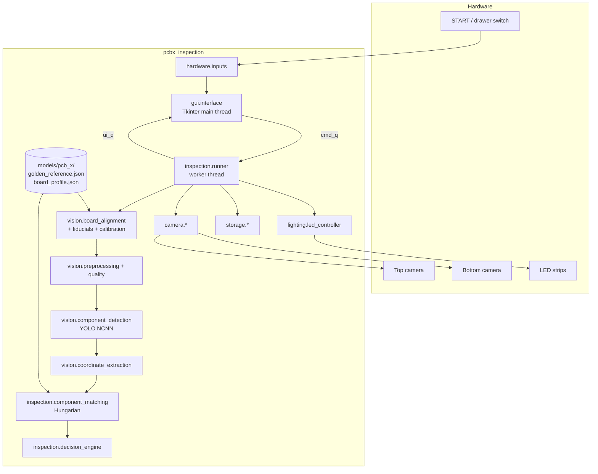
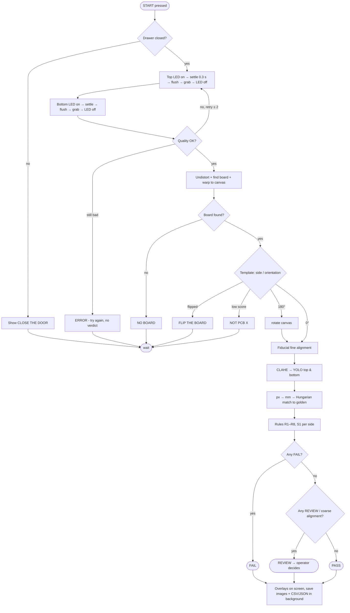

# Package C — Raspberry Pi software: architecture, roadmap, deployment (V2)

V2 summary: two Camera Module 3 units named by position (`upper` CAM1,
`lower` CAM0); every image is identified as FRONT or BACK from the board's
markings; dual mode (one insertion, both cameras) or flip mode (one camera,
operator flips); PCB profile folder `models/pcb_x/`; GUI Settings and History.
Stage 7 now ends with `tools/check_profile.py`; Stage 9 writes into
`models/pcb_x/golden_reference.json`.

The complete source is in `pcbx_inspection/`. This document explains how it is
organised, in which order to bring it up, how to check each stage, and how
to deploy it as an appliance.

---

## C1. Development environment (Part 3.1)

**Use VS Code, not Thonny**, for a multi-file project: project-wide search,
"go to definition", Git integration, a debugger, and — most useful here — the
**Remote-SSH** extension, which lets you edit and run code *on the Pi* from
your Windows laptop as if it were local. Thonny is fine for a single script,
but becomes awkward with 30 files in packages.

**Recommended workflow**

| Where | What |
|---|---|
| Windows laptop (VS Code) | Write/refactor code, run `pytest`, test logic offline with saved images (`tools/run_offline.py`), run the GUI in `--simulate` mode, train models (or Colab) |
| Raspberry Pi (via VS Code Remote-SSH) | Anything touching cameras, LEDs, GPIO, timing; final testing |
| GitHub (private repo) | Single source of truth. `git pull` on the Pi after pushing from the laptop. Commit `references/` after calibration. Never commit `logs/` or large datasets |

Enable SSH on the Pi (`sudo raspi-config` → Interface Options → SSH), then in
VS Code: *Remote-SSH: Connect to Host* → `user@<pi-ip>`.

---

## C2. Software architecture (Part 3.2)

```
pcbx_inspection/
├── main.py                    entry point (--simulate, --windowed, --mode dual|flip, --profile)
├── config.py                  system settings: cameras (upper/lower), LEDs, GPIO, pipeline defaults
├── config/settings.json       values saved from the GUI (validated whitelist)            [V2]
├── camera/                    one interface, three back-ends
│   ├── base.py                BaseCamera: open() / capture(fresh) / close()
│   ├── picam_camera.py        Camera Module 3 via Picamera2 (detects IMX708)            [V2 M]
│   ├── uvc_camera.py          optional USB-webcam fallback
│   └── file_camera.py         images from a folder (--simulate, tests)
├── lighting/led_controller.py WS2812B over SPI | GPIO MOSFET | dummy
├── hardware/inputs.py         START button, drawer switch, status LED (gpiozero)
├── vision/
│   ├── calibration.py         per-camera lens calibration (+ optional fixed homography)
│   ├── quality.py             blur / exposure check
│   ├── identification.py      FRONT/BACK identification from markings, 0/180 deg      [V2 N]
│   ├── board_alignment.py     outline -> identification -> orientation -> holes -> canvas [V2 M]
│   ├── fiducials.py           mounting-hole detection, similarity fit
│   ├── preprocessing.py       CLAHE / gamma (shared with dataset capture)
│   ├── component_detection.py YOLO wrapper (.pt / NCNN), validated loading              [V2 M]
│   └── coordinate_extraction.py  canvas px <-> board mm
├── inspection/
│   ├── profile.py             PCB profile folder: metadata, model files, readiness     [V2 N]
│   ├── golden_reference.py    schema v2, tolerances, validation, safe save + backups   [V2 M]
│   ├── component_matching.py  Hungarian assignment (one-to-one)
│   ├── decision_engine.py     rules R1-R9, S1, S2 -> PASS / FAIL / REVIEW              [V2 M]
│   └── runner.py              dual / flip sequences, side assignment, logging          [V2 M]
├── gui/interface.py           main screen (results, side info, preview, flagged table)  [V2 M]
├── gui/settings_window.py     profile/model, inspection, tolerances, golden JSON       [V2 N]
├── gui/history_window.py      history, HTML report, CSV export                         [V2 N]
├── gui/overlay.py             coloured boxes
├── storage/                   image logger, result logger (CSV/JSON), HTML report      [V2 M/N]
├── models/pcb_x/              PCB profile: metadata, golden, board profile, top/ bottom/ models [V2 N]
├── references/calibration/    upper_camera.json, lower_camera.json
├── tools/                     stage tests and setup utilities (see C3), check_profile.py [V2]
├── tests/                     pytest: decision rules, 15 V2 scenarios, GUI smoke test
├── requirements.txt  install_pi.sh  run_pcbx.sh  deploy/
```

Changes from your proposed structure: `hardware/` added (buttons/switch);
`fiducials.py`, `quality.py`, `calibration.py` separated from alignment
(each is testable alone); `runner.py` added — it is the only module that
knows the *order* of steps, so the GUI stays simple and the same pipeline
runs offline (`process()`); `camera/file_camera.py` enables development
without hardware; `tools/` and `tests/` hold everything that is not the
running appliance.

### C2.1 How modules communicate

* **Data flows one way**: `camera` → numpy image → `vision.board_alignment` →
  `AlignResult(canvas)` → `vision.preprocessing` → `vision.component_detection`
  → `Detection` list → `vision.coordinate_extraction` → `Observed` (mm) →
  `inspection.component_matching` → pairs → `inspection.decision_engine` →
  `SideResult`/verdict → `gui` + `storage`.
* **Only `runner.py` calls hardware** (`camera`, `lighting`). Vision and
  inspection modules are pure functions of their inputs → unit-testable.
* **Only `config.py` holds numbers** — no thresholds hidden in modules.
* **GUI ↔ worker**: the Tkinter main thread never blocks. A worker thread runs
  `InspectionSystem`; commands go in through `cmd_q`, results come back
  through `ui_q` (polled every 50 ms). The physical START button only puts a
  command into the queue.

### C2.2 System architecture diagram



### C2.3 Software workflow (one board)



---

## C3. Step-by-step development roadmap (Part 3.3)

Do the stages **in order**; each ends with a check. All commands run in
`~/PCBX_Capstone/pcbx_inspection` with the venv active
(`source ~/pcbx-venv/bin/activate`).

### Stage 1 — Raspberry Pi OS and dependencies
* **Objective:** reproducible software base.
* **Files:** `install_pi.sh`, `requirements.txt`.
* **Steps:** Flash **Raspberry Pi OS (64-bit) with desktop** using Raspberry Pi
  Imager (set user, Wi-Fi, SSH there). Ultralytics' Pi guide was tested on
  Bookworm; current Pi OS releases are newer — the installer handles both.
  Then: `sudo apt update && sudo apt full-upgrade -y && sudo reboot`, copy the
  project (`git clone ...`), `chmod +x install_pi.sh && ./install_pi.sh`, reboot.
* **Expected output:** the installer's self-test prints `OK` for numpy, cv2,
  torch, ultralytics, ncnn, scipy, PIL.ImageTk, tkinter, spidev, gpiozero, picamera2.
* **Verify:** `python -m pytest -q tests` → `39 passed` (the GUI test is skipped without a display).
* **Why the venv uses `--system-site-packages`:** Picamera2/libcamera are apt
  packages compiled for the system Python; a normal venv cannot see them.
  **Why numpy is pinned:** pip would otherwise install a newer numpy into the
  venv, and apt's Picamera2 (built against the system numpy) can then fail
  to import. **Why CPU-only torch:** the default PyPI torch may be a CUDA build
  that is large and, on some Pi setups, crashes with "Illegal instruction".

### Stage 2 — Camera initialisation and testing
* **Objective:** both cameras deliver stable, focused frames with locked settings.
* **Files:** `camera/*`, `tools/test_cameras.py`, `config.py` → `CAMERAS`.
* **Steps:**
  1. `rpicam-hello --list-cameras` (CSI) and `v4l2-ctl --list-devices` (USB).
     Camera Module 3 is auto-detected; Arducam IMX519 needs
     `dtoverlay=imx519,cam0` in `/boot/firmware/config.txt` (+ Arducam's
     libcamera for focus — follow their guide).
  2. `python tools/test_cameras.py --list` and `--both-streaming` → both IMX708
     cameras seen, upper/lower mapping correct (swap `camera_num` if not).
  3. Place a board, then focus sweep:
     `python tools/test_cameras.py --camera lower --focus-sweep 4 14 0.5` and
     `python tools/test_cameras.py --camera upper --focus-sweep 4 14 0.5` → put the
     best values in `config.py`.
  4. Adjust exposure until the board is bright but not clipped.
  5. `python tools/test_cameras.py` (10 captures per camera).
* **Expected output:** resolution as configured; `brightness std < 2.0`,
  `sharpness CV < 5 %`, capture < 1 s per side, `RESULT: PASS`.
* **Verify / decide:** if the EMEET fails the lock test, switch the top side to
  a CSI camera (A2.1). Write down the final camera height and settings.

### Stage 3 — LED control
* **Objective:** each strip switches independently, white, no flicker.
* **Files:** `lighting/led_controller.py`, `tools/test_leds.py`.
* **Steps:** wire per Package A (shifter, common ground, separate supply);
  `python tools/test_leds.py`, then `--interactive`.
* **Expected output:** TOP only → BOTTOM only → OFF → 3 blinks; switch time a
  few ms.
* **Verify:** colours wrong (green looks red) → `color_order`; random colours
  on far LEDs → ground or level shifter; nothing → SPI not enabled (`ls /dev/spidev0.0`).

### Stage 4 — Image capture
* **Objective:** the LED-synchronised capture (`InspectionSystem.capture_side`).
* **Steps:** `python tools/test_cameras.py` again with LEDs connected; tune
  `LED_SETTLE_S` (start 0.3 s, try 0.1 s) and `flush_frames` (EMEET 5,
  CSI 2): the image must look identical to one taken with a long wait.
* **Verify:** take 10 captures with `LED_SETTLE_S=0.3` and 10 with your
  shorter value — mean brightness must match within ±2.

### Stage 5 — Image preprocessing
* **Objective:** the photometric steps used for BOTH training and inspection.
* **Files:** `vision/preprocessing.py`, `vision/quality.py`, `config.PREPROCESS`, `config.QUALITY`.
* **Steps:** view a canvas with/without CLAHE (Stage 6 produces canvases).
  Keep CLAHE (clip 2.0, 8×8) unless dark parts are still invisible → try
  `gamma 1.2`. Set `QUALITY.min_sharpness` to ~50 % of the sharpness of good
  captures, brightness limits ±40 around the good mean.
* **Verify:** a deliberately defocused or dark capture is rejected; good ones pass.

### Stage 6 — Calibration and board alignment
* **Objective:** every image becomes a 1200 × 500 px canvas, 10 px/mm, same orientation.
* **Files:** `tools/calibrate_camera.py`, `tools/build_board_profile.py`,
  `tools/test_alignment.py`, `vision/board_alignment.py`, `vision/fiducials.py`.
* **Steps:**
  1. Calibrate each camera (15–20 checkerboard photos):
     `python tools/calibrate_camera.py --camera lower --capture 20` (and `--camera upper`).
  2. Measure the board with calipers → `BOARD_WIDTH_MM/HEIGHT_MM`.
  3. Teach the board per side (fiducials + templates), see the tool's header:
     `--capture`, then `--capture --keep 0 3`, then `--capture --flipped`.
  4. Test 4 situations × 10 insertions: normal, rotated 180°, flipped, empty
     tray: `python tools/test_alignment.py --camera upper --images <folder> --expect top`
     (see `docs/PCB_IDENTIFICATION_AND_ORIENTATION.md`).
* **Expected output:** calibration RMS < 0.5 px (webcam < 1.0 px); alignment
  100 % correct per situation; fiducial residual < 0.15 mm.
* **Verify:** open `test_output/alignment/<side>/` — canvases must look
  identical (board in the same place) for all insertions.

### Stage 7 — Dataset capture, training and YOLO integration
* **Objective:** trained models running on the Pi.
* **Files:** `tools/capture_dataset.py`, `training/*`, `vision/component_detection.py`.
* **Steps:** pilot set first (30 canvases per side → label → train → check the
  small parts are found), then the full dataset (Package B). Copy the NCNN
  models into the profile (`training/export.py --profile-dir ../pcbx_inspection/models/pcb_x`)
  and run `python tools/check_profile.py` (docs/MODEL_INTEGRATION.md).
* **Verify:** `python tools/benchmark.py` prints per-side inference time; the
  class-list check passes (a swapped model raises an error).

### Stage 8 — Coordinate extraction
* **Objective:** box centres in board millimetres.
* **Files:** `vision/coordinate_extraction.py`.
* **Verify:** measure two parts' centre distance with calipers (or from the
  Gerber/CAD) and compare with the difference of their `x_mm/y_mm` in a
  `result.json`: agreement within ~0.2 mm.

### Stage 9 — Golden reference
* **Objective:** `models/pcb_x/golden_reference.json` (both sides; docs/GOLDEN_REFERENCE_AND_TOLERANCES.md).
* **Files:** `tools/build_golden_reference.py`, `inspection/golden_reference.py`.
* **Steps:** 10+ known-good boards × 3 insertions (`capture_dataset.py --note good`),
  build with `--seed-label` (one hand-checked label file), rename IDs to the
  silkscreen designators, review the spread table.
* **Expected output:** every component `seen` in ≥ 90 % of images, std < 0.1 mm.
* **Verify:** the component count per class equals the BOM.

### Stage 10 — Rule-based inspection
* **Objective:** correct verdicts for known cases.
* **Files:** `inspection/component_matching.py`, `inspection/decision_engine.py`, `tests/`.
* **Steps:** `python -m pytest -q tests`; then `tools/run_offline.py` on a set
  of known-good and known-defect captures; tune `T_LOW`, `T_HIGH` and
  tolerances on **validation boards only**.
* **Verify:** no defective board PASSes; REVIEW rate acceptable (agree a target
  with your adviser, e.g. < 10 %).

### Stage 11 — GUI
* **Files:** `gui/interface.py`, `gui/overlay.py`, `main.py`.
* **Steps:** on the laptop `python main.py --simulate --windowed` (needs
  `sim_images/top|bottom/*.jpg`, models and golden files); on the Pi
  `python main.py`.
* **Verify:** START (screen, button, space bar) runs one inspection; GUI never
  freezes; banner colours; Operator PASS/FAIL enabled only on REVIEW.

### Stage 12 — Image and result logging
* **Files:** `storage/*`.
* **Verify:** each board creates `logs/<date>/<board_id>/` with raw, canvas,
  overlay images and `result.json`; `logs/results.csv` opens in Excel.

### Stage 13 — Full integration and testing
* Run Package D (camera, LED, alignment, model, golden, decision, system,
  performance tests). Then the test set **once**.

### Stage 14 — Deployment as an appliance (Part 3.4)
See C4.

---

## C4. Compilation and deployment (Part 3.4)

| Option | What it is | For this project |
|---|---|---|
| Running Python scripts | `python main.py` — the interpreter reads the source | **Yes — this is how it runs** |
| Virtual environment | Private folder of packages for one project (`~/pcbx-venv`) | **Yes** — isolates exact versions |
| Standalone executable (PyInstaller, Nuitka) | Bundles Python + packages into one Linux binary | **No** — Picamera2/libcamera, NCNN and PyTorch are hard to bundle; builds are huge and break on OS updates; gains nothing on a dedicated Pi |
| Packaging (pip package, .deb) | Installable distribution | Not needed for one appliance |

No compilation is needed. A Windows `.exe` is irrelevant: the Pi runs the
`.py` files directly, inside the venv.

**Make it an appliance**

1. `sudo raspi-config` → *System Options → Boot / Auto Login → Desktop Autologin*.
2. Autostart after login — **recommended:** desktop autostart entry
   ```bash
   mkdir -p ~/.config/autostart
   cp deploy/pcbx.local.desktop ~/.config/autostart/pcbx.desktop   # created by install_pi.sh
   ```
   *Alternative:* the systemd **user** service in `deploy/pcbx.service`
   (instructions inside the file; logs via `journalctl --user -u pcbx`).
   A *system* service is not recommended for a GUI: it starts before the
   desktop exists and has no display.
3. `run_pcbx.sh` restarts the program automatically after a crash (logged in
   `logs/restarts.log`). "Exit" in the GUI stops it cleanly.
4. Full-screen is on by default (`config.FULLSCREEN`); Esc leaves full-screen
   for maintenance.
5. Optional: hide the taskbar, disable screen blanking (*Raspberry Pi
   Configuration → Display → Screen Blanking: off*).
6. Updates: `git pull` → restart. Never edit code on the appliance without committing.
