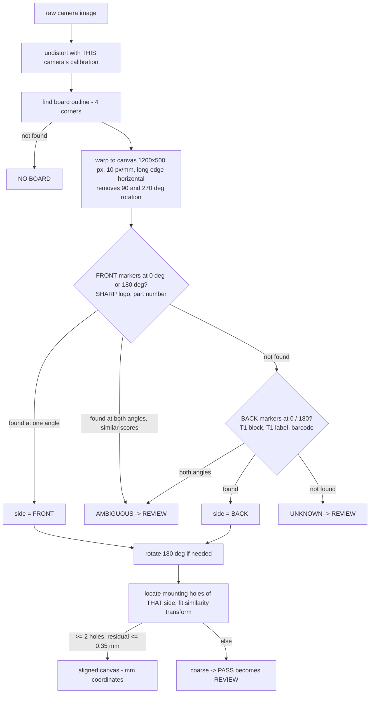

# PCB identification and orientation correction (V2)

Two different questions, answered by two different steps:

| Step | Question | Method | Module |
|---|---|---|---|
| Identification | *Which side is this, and is it upside-down?* | template matching of the board's own markings (+ optional barcode) | `vision/identification.py` |
| Alignment | *Exactly where is it, to a tenth of a millimetre?* | board outline + mounting holes | `vision/board_alignment.py`, `vision/fiducials.py` |

Finding the SHARP logo proves the image shows the front. It does **not** prove
the board is positioned accurately enough to measure a 0.5 mm shift. That is
why the mounting holes are measured afterwards, and why "holes not found"
turns a would-be PASS into REVIEW.

---

## 1. The pipeline for one image



### Why there is no mirroring
A camera that looks at a face of the board sees that face the right way round
(no mirror in the light path). When the board is flipped, the camera sees the
**other face** — a different image, not a mirrored one. So the software never
mirrors pixels; it identifies which face it sees and uses that face's own
references. Mirroring the image would put every component at the wrong place.

### Why flipping does not break coordinates
Every side has its own coordinate system: millimetres from the top-left corner
of that side **after** orientation correction. The front golden reference is
in front coordinates, the back golden reference in back coordinates. Whichever
camera sees the front, its image is warped into front coordinates before
comparison, so the same golden reference applies.

### Rotations handled
| Placement | What happens |
|---|---|
| normal | markers match at 0° → no change |
| rotated 180° (in the tray) | markers match at 180° → canvas rotated |
| rotated 90° / 270° (camera mounted turned, or board placed sideways without a nest) | the outline step makes the long edge horizontal, then 0/180 as above |
| flipped (other side up) | the other side's markers match → inspected as that side (dual mode), or "same side again" prompt (flip mode) |
| tilted a few degrees | removed by the outline warp and the hole fit |

---

## 2. Markers (`models/pcb_x/board_profile.json`)

```json
"top": {
  "min_markers": 1,
  "markers": [
    {"name": "sharp_logo", "type": "template", "x_mm": 28.5, "y_mm": 41.5,
     "w_mm": 9.0, "h_mm": 3.0, "template": "templates/top_sharp_logo.png",
     "min_score": 0.6, "search_mm": 4.0}
  ],
  "fiducials_mm": [[4.0, 4.0, 3.2], [111.0, 4.0, 3.2], [4.0, 41.0, 3.2], [111.0, 41.0, 3.2]],
  "template": "templates/top_whole.png"
}
```

* `x_mm, y_mm` = centre of the marker rectangle on the normalised side; `w_mm, h_mm` = size.
* `search_mm` = how far the marker may be from its expected position (tray play + coarse-warp error).
* `min_score` = normalised cross-correlation needed (−1…1). Start 0.6, tune in Stage 6.
* `min_markers` = how many markers must be found. 1 tolerates one covered marker (e.g. by tape).
* `type: "barcode"` = optional barcode area (no template file).
* `template` (side level) = whole-board image, used only if no marker is configured.
* `fiducials_mm` = mounting holes `[x, y, diameter]`.

**Reliable reference coordinates.** Never type marker coordinates from a phone
photo. Capture the board **in the chamber** (`build_board_profile.py
--capture`): the tool warps it to the canvas and draws a millimetre grid
(`test_output/profile/<side>_canvas.jpg`). Read the rectangle from that grid.
Because the template is cut from the same kind of canvas the inspection uses,
scale and lighting match automatically. The `golden_reference.example.json`
and `board_profile.example.json` positions are rough estimates from your
photos — for format only.

**Choosing good markers**
1. printed on **every** unit (silkscreen), not the per-unit "PWR21100004" sticker or tape;
2. high contrast and textured (text, logo, the white T1 block);
3. **not symmetric under 180°** — the tool prints the score at 180° and warns if it is too high;
4. not covered by tall parts' shadows; two markers per side so one may be covered.

---

## 3. Calibration procedure (do in this order)

| # | Step | Command | Check |
|---|---|---|---|
| 1 | Lens calibration, each camera | `python tools/calibrate_camera.py --camera upper --capture 20` (then `lower`) | RMS < 0.5 px |
| 2 | Measure board, set `board_size_mm` in `models/pcb_x/metadata.json` | calipers | — |
| 3 | Front, normal orientation, upper camera: look | `python tools/build_board_profile.py --side top --camera upper --capture` | canvas looks like your "SIDE A NORMAL" slide; else add `--rotate180` |
| 4 | Store holes | `... --side top --camera upper --capture --keep <numbers of the 4 holes>` | 4 fiducials stored |
| 5 | Front markers | `... --side top --camera upper --capture --marker sharp_logo X Y W H --marker part_number X Y W H` | self-score ≈ 1.0, 180° score < 0.6 |
| 6 | Back: insert board back-side up (or use the lower camera with normal insertion) | `... --side bottom --camera lower --capture --keep ... --marker t1_white_block X Y W H --marker t1_label X Y W H` | same |
| 7 | Test every case, ≥ 20 images each | `python tools/test_alignment.py --camera upper --images <set> --expect top` | 100 % correct |

Test sets for step 7 (capture with `capture_dataset.py`): front normal,
front 180°, back normal, back 180°, other board / empty tray (`--expect
unknown` / `no_board`), a board with one marker covered (still identified),
both markers covered (`unknown`).

If identification fails on real images: lower `min_score` slightly (not below
~0.5), increase `search_mm` if the tray has play, or choose a more distinctive
marker. If both 0° and 180° match: choose a less symmetric marker.

---

## 4. Explaining it in the defense (short version)

1. "We straighten the board using its outline, so every image has the same scale and the long edge horizontal."
2. "We look for printed markings that exist on every unit — SHARP and the part number on the front, the T1 block on the back. Front first, then back. If none is found, the system says REVIEW instead of guessing."
3. "Where the marking is found tells us whether the board is upside-down; we rotate the image back."
4. "Then we measure the four mounting holes to align the image to a tenth of a millimetre. Only then do we compare component positions with the golden reference."
5. "Identification and alignment are separate on purpose: recognising a logo does not mean the board is accurately positioned."
